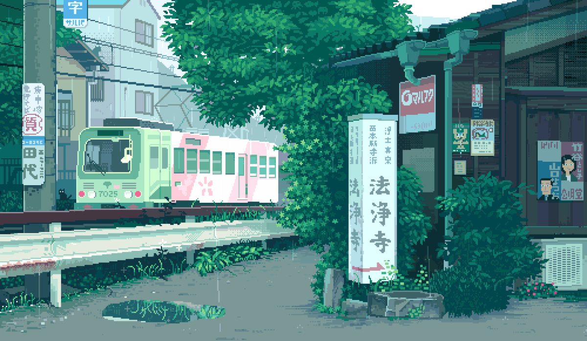

  

  

Computer Science student at **Tecnológico de Monterrey** (graduating June 2027), based in Monterrey, MX.

- 💼 Software Engineer Intern at **Softtek**
- 🔭 Interested in Backend, Devops and AI
- 🌱 I like reading, videogames and painting 

📫 https://www.linkedin.com/in/vaniamichelle/
